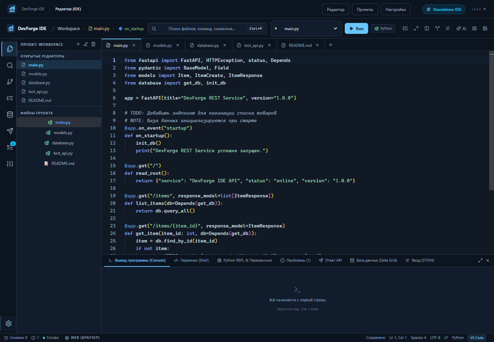
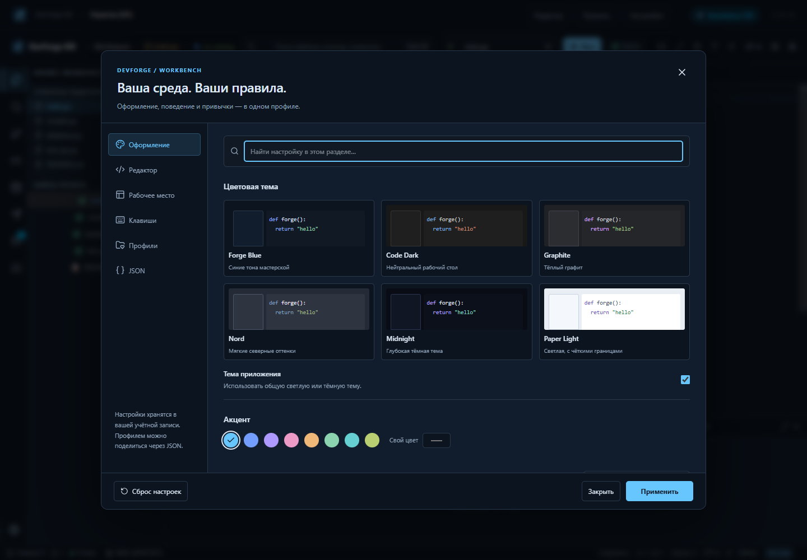

# DevForge 1.0.0

Локальная среда разработки для Windows с редактором Monaco, учебными материалами
и настраиваемым рабочим пространством. Исходный код открыт под [MIT](LICENSE).

**[Скачать установщики](https://github.com/tortovskey/DevForge/releases/tag/v1.0.0)** ·
[Изменения](CHANGELOG.md) · [Участие в разработке](CONTRIBUTING.md) · [Безопасность](SECURITY.md)



## Две версии

| Версия | Назначение | Установка | Переносимый запуск |
|---|---|---|---|
| IDE | Редактор, проекты и инструменты разработки | `IDE/Setup.exe` | `IDE/DevForgeIDE.exe` |
| Desktop | Учебные материалы и IDE в отдельном окне | `Desktop/Setup.exe` | `Desktop/DevForge.exe` |

В версии 1.0.0 поставка Web удалена. Иконка приложения — голубая кузница с печью и дымоходом.
Windows 10/11 x64; для окон нужен Microsoft Edge WebView2. При его отсутствии
установщик предлагает официальный загрузчик Microsoft; этому шагу нужен интернет.
Установщики пока не подписаны сертификатом издателя.

## Рабочее место

- Шесть тем, свои акценты и отдельные цвета панелей и редактора.
- Раскладки Code, Studio и Focus, панели слева/справа/снизу, перетаскиваемые границы.
- Шрифты, лигатуры, интервалы, отступы, перенос строк, направляющие и курсор.
- Схемы клавиш VS Code и JetBrains с переопределениями и проверкой конфликтов.
- До 12 профилей; импорт/экспорт JSON, проверка схемы и сброс настроек.
- Палитра команд (F1), разделение редактора, поиск, локальные снимки, Python REPL.

Открыть настройки: кнопка с ползунками над редактором или `Ctrl+,`.
Режим фокуса: `Ctrl+Shift+F12`; кнопка возврата остаётся доступной.



## Запуск из исходников

Требуются Git, Node.js 22.12+ (рекомендуется 24 LTS), Python 3.12 и WebView2.
Сборка загружает зависимости из npm, PyPI и закреплённые среды исполнения.
Дополнительные Clang/SQLite файлы проверяются по SHA-256. В готовой программе они локальные.

```powershell
git clone https://github.com/tortovskey/DevForge.git
cd DevForge/IDE/Source
./setup.bat
./start.bat                 # IDE
# & './Start Desktop.bat' # обучение + IDE
```

Исходники находятся в `IDE/Source/backend`, `frontend`, `content`, `assets`, `scripts`.
Готовые EXE, базы, личные проекты, `.venv` и `node_modules` не хранятся в Git.
Данные приложений сохраняются в `%LOCALAPPDATA%/DevForgeIDE/data` и
`%LOCALAPPDATA%/DevForge/data`; деинсталлятор их сохраняет.

## Проверки и разработка

```powershell
cd IDE/Source
$env:DEVFORGE_DATA_DIR = "$PWD/build/test-data"
cd backend
../.venv/Scripts/python.exe -m pytest -q
cd ../frontend
npm run typecheck
npm run test:runner
npm run build
```

Для интерактивной разработки в первом терминале из `IDE/Source/backend`:

```powershell
$env:DEVFORGE_DATA_DIR = "$PWD/../build/dev-data"
../.venv/Scripts/python.exe -m uvicorn app.main:app --host 127.0.0.1 --port 8000
```

Во втором терминале из `IDE/Source/frontend` выполните `npm run assets`, затем
`npm run dev -- --port 5174`. Тесты: `npm test -- ide.spec.ts security.spec.ts workbench.spec.ts`.
Браузер здесь служит инструментом разработки интерфейса. Отдельной поставки Web нет.

## Сборка Windows

Из `IDE/Source` установите `pip install -r scripts/requirements-build.txt` в `.venv`
и Inno Setup. Затем:

```powershell
./scripts/build-deliverables.ps1 -InnoCompiler "C:/Program Files (x86)/Inno Setup 7/ISCC.exe"
```

Результат: `build/distribution/IDE` и `build/distribution/Desktop`, в каждой папке
программа и `Setup.exe`. Проверка EXE: `.venv/Scripts/python.exe scripts/verify_native.py`.
Проверка установки/обновления/удаления в тестовой папке: `scripts/verify-installers.ps1`.

## Границы возможностей

Код запускается в браузерных Workers внутри WebView2. Для части языков используются
учебные интерпретаторы с ограниченной совместимостью. Терминал поддерживает команды
DevForge; снимки файлов хранятся локально. Системный shell, серверный FastAPI и Git
не заменяются учебными средами. Локальный API предназначен для `127.0.0.1`.

Архитектура настроек и точек расширения: [WORKBENCH.md](IDE/Source/WORKBENCH.md).
Сторонние компоненты сохраняют свои [лицензии](IDE/Source/licenses/THIRD-PARTY.md).
